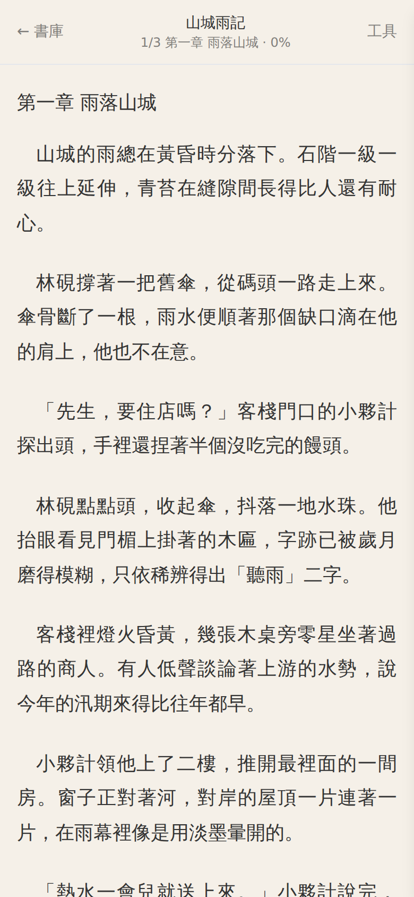
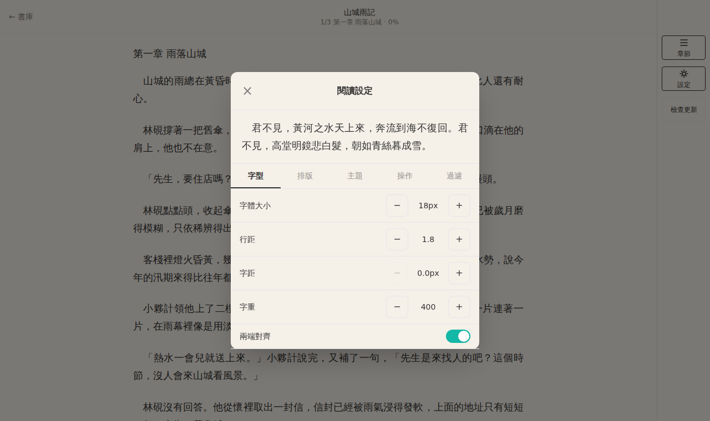
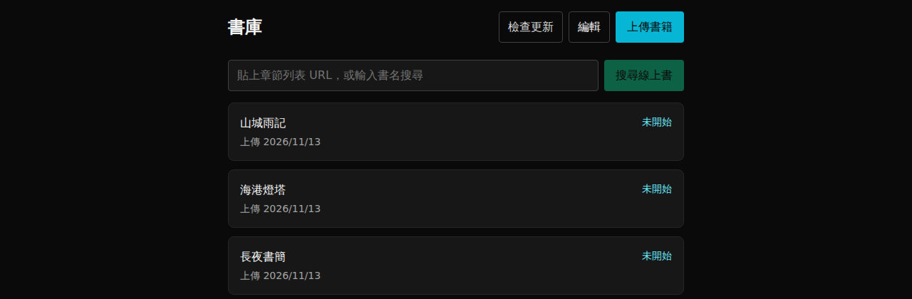

# chinese-txt-reader

長篇中文 TXT 小說閱讀器，Web／PWA，電腦與手機都能用。
A self-hosted PWA for reading long Chinese TXT novels, with offline reading and cross-device progress sync.

<p>
  
  
</p>

## 功能

- **雲端書庫**：上傳 `.txt`（單檔上限 20MB），自動判斷 UTF-8／Big5／GB18030 編碼並轉成 UTF-8 保存。
- **閱讀**：虛擬捲動，長篇也不卡；章節自動切分與跳轉，標頭顯示章節與章內百分比。
- **閱讀設定**：字體大小、行距、字距、字重、顏色主題、段距與縮排、兩端對齊、硬換行合併、繁簡轉換、內文廣告字串過濾；設定先存本機，再同步到雲端。
- **跨裝置進度**：進度以章節儲存，換裝置接著讀；兩端差距大時讓你選要用哪一端。
- **離線閱讀**：可安裝成 PWA；書籍可下載整本，或從目前章節下載到結尾，存進 IndexedDB，沒網路也能讀。
- **手機操作**：點擊捲動、可收合工具列、閱讀時螢幕常亮。
- **網頁目錄**：貼上小說章節目錄頁的網址，以通用解析器抓章節加入書庫。本專案不附任何特定網站的書源定義，請只用於你有權閱讀的內容。



## 架構

| 部分 | 技術 |
|---|---|
| frontend | React、Vite、Tailwind、Dexie（IndexedDB）、Workbox PWA |
| backend | Node.js、Fastify、SQLite（better-sqlite3） |
| 登入 | 不自建帳號；由前置的反向代理驗證身分，以 header 傳入使用者名稱，後端依此隔離每個人的書庫 |

## 本機試用

開發模式不檢查登入，所有請求都視為同一個使用者。

```bash
npm install
npm run dev:backend    # API：127.0.0.1:3005
npm run dev:frontend   # 打開 http://localhost:5174/reader/
```

型別檢查與測試：

```bash
npm run lint
npm test
```

## 自行部署

開發與正式環境使用 Node.js 24。

### 1. 建置

```bash
npm ci
npm run build
```

### 2. 啟動後端

```bash
NODE_ENV=production \
HOST=127.0.0.1 PORT=3005 \
RAPH_READER_DATA_DIR=/var/lib/chinese-txt-reader \
RAPH_READER_UPLOADS_DIR=/var/lib/chinese-txt-reader/uploads \
npm -w backend run start
```

| 變數 | 預設 | 說明 |
|---|---|---|
| `NODE_ENV` | — | 設成 `production`。設成 `development` 會關掉登入檢查，所有人共用同一個書庫 |
| `HOST`／`PORT` | `127.0.0.1`／`3005` | API 監聽位址；前端的 proxy 固定指向 `127.0.0.1:3005`，改 port 要同步改 `frontend/vite.config.ts` |
| `RAPH_READER_DATA_DIR` | `backend/data` | SQLite 資料庫所在目錄 |
| `RAPH_READER_DB_PATH` | `<DATA_DIR>/raph-reader.db` | 資料庫檔案路徑 |
| `RAPH_READER_UPLOADS_DIR` | `backend/uploads` | 上傳原檔與轉碼後文字 |

資料目錄與 uploads 目錄就是全部的伺服器端資料，備份這兩個即可；建議放在 repo 之外，避免清理或重新建置時誤刪。

### 3. 啟動前端

```bash
READER_ALLOWED_HOSTS=reader.example.com npm -w frontend run preview
```

前端在 `127.0.0.1:5174` 的 `/reader/` 底下提供頁面，並把 `/reader/api` 轉給後端。`READER_ALLOWED_HOSTS` 填對外網域，多個以逗號分隔。

### 4. 反向代理與登入

後端信任反向代理傳入的 `Remote-User`（或 `X-Forwarded-User`）header，所以：

- 只讓反向代理對外，後端與前端都綁 `127.0.0.1`。
- 代理先驗證身分，再自己設定 `Remote-User`，並移除使用者自帶的同名 header。

Caddy 加 Basic Auth 的最小設定：

```caddyfile
reader.example.com {
	redir / /reader/
	basic_auth {
		alice <caddy hash-password 產生的雜湊>
	}
	request_header -X-Forwarded-User
	reverse_proxy 127.0.0.1:5174 {
		header_up Remote-User {http.auth.user.id}
	}
}
```

oauth2-proxy 這類 forward auth 也可以，只要把通過驗證的使用者名稱放進 `Remote-User`。登入過期時，書庫頁的「重新登入」會導到同網域的 `/auth/?rd=<閱讀器網址>`；登入頁掛在別處的話，改 `frontend/src/api.ts` 的 `loginToReader`。

## 關於這個 repo

這是私有開發 repo 的淨化同步版，大約每兩週到一個月更新一次，每次同步是一個 commit。

## 授權

[MIT](LICENSE)
